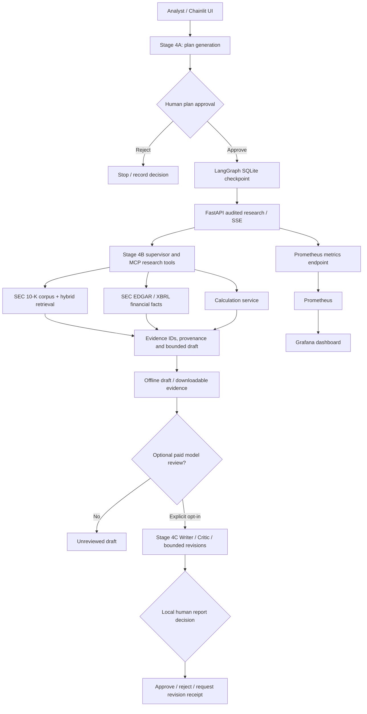

# AnalystDesk — Agentic SEC Financial Research Workbench

**IIT Bombay / Great Learning — Agentic AI Capstone**  
**Team:** Nishikanta Mohanty and Amit Tripathy  
**Submission:** Local research prototype; not a production investment-advice service.

AnalystDesk is a local, evidence-first, multi-stage financial research workbench. It helps an analyst compare two supported US-listed companies using annual SEC Form 10-K disclosures and SEC XBRL financial facts. The workflow separates **planning, human plan approval, research, draft construction, optional LLM Writer–Critic review, and local human report decisions**. Citations and numeric evidence are tracked separately from model-generated narrative.

> **Reproducibility notice:** This repository holds application source, configuration, security tests and automated tests. The large SEC filing corpus, pinned hybrid index, local checkpoints and runtime evidence are **not stored in Git**. A source-only clone cannot reproduce the 12-company demonstration until the separately supplied verified dataset and required runtime files are restored. See [Data and reproducibility](#data-and-reproducibility).

## Quick start: one command (after one-time setup)

**Windows 11 / CMD**, from the **repository root**, with Docker Desktop running, a prepared `.env`, the verified SEC dataset restored, and the `analystdesk-ui` Conda environment installed:

```bat
docker compose up -d --build && conda run -n analystdesk-ui --no-capture-output python -m chainlit run chainlit_app.py --host 127.0.0.1 --port 8001
```

This one-line command starts the **FastAPI research service, Prometheus and Grafana** using Docker Compose, then launches the **Chainlit UI** in the foreground. It deliberately keeps service ports bound to local loopback. The individual Docker and Chainlit startup paths have been exercised on the project laptop; **this combined one-line invocation has not been independently regression-tested**.

| Component | Local address |
| --- | --- |
| Chainlit research UI | http://127.0.0.1:8001 |
| FastAPI health check | http://127.0.0.1:8000/healthz |
| Prometheus target health | http://127.0.0.1:9090/targets |
| Grafana dashboard | http://127.0.0.1:3000 (admin / locally configured password) |

Press **Ctrl+C** to stop Chainlit, then run `docker compose stop` to stop the Docker services without deleting volumes. **Do not use `docker compose down -v`** if you wish to retain monitoring data and other volumes.

## One-time prerequisites and configuration

1. Install **Docker Desktop** with Docker Compose, **Miniconda/Anaconda**, and **Git**. The validated demonstration used Windows, Docker Desktop, and Python 3.11-based Conda environments.
2. From the repository root, create the isolated Chainlit environment and install its dependencies:

   ```bat
   conda create -n analystdesk-ui python=3.11 -y
   conda run -n analystdesk-ui python -m pip install -r requirements-phase10.txt
   ```

3. Restore the verified local SEC release and indexes under `data/`, including `data/verified_coverage/runs/20261101T100701Z_1219a55c/10k_verified_passages.jsonl` and its `hybrid_index/`. Restore any additional permitted SEC cache/companyfacts assets needed by the chosen demo. These assets are provided separately and are **not** included in a clone of this repository.
4. Create `data/checkpoints/`, `docker_runtime/checkpoints/` and `evidence/` if they do not already exist. Check that Docker Desktop can access the working directory.
5. Copy `.env.example` to `.env` and edit it **locally**. Required for the 12-company Compose/monitoring setup:

   ```dotenv
   EDGAR_USER_AGENT=AnalystDeskCapstone your-real-contact-email@example.com
   ANALYSTDESK_VERIFIED_RELEASE_ID=20261101T100701Z_1219a55c
   GRAFANA_ADMIN_PASSWORD=choose-a-strong-local-password
   ```

   Replace the example SEC contact email and Grafana password. **Never commit `.env`, tokens, private records or secrets.** The optional live Writer–Critic path additionally requires `OPENROUTER_API_KEY` in the local `.env`; no OpenRouter key is needed for the offline research path. The long-running FastAPI API does not receive that key through Compose.
6. Ensure the locally restored data release matches the configured immutable `ANALYSTDESK_VERIFIED_RELEASE_ID`. A different release must be explicitly configured, not silently selected through a changing “latest” pointer.

**Fresh-install caveat:** The repository does not currently ship a self-contained data bootstrap or a fully validated one-command *installation*. The command above is a one-command **startup** for an environment prepared using these steps. The full offline demo depends on additional distribution artifacts.

## Supported scope

The verified local demonstration release contains **12 companies, three annual filings per company, 36 filings total**, with extracted Form 10-K Items **1A (risk factors), 7 (management discussion and analysis), and 8 (financial statements)**. The selected companies are:

| Technology | Retail / commerce |
| --- | --- |
| AAPL, ADBE, CRM, GOOGL, META, MSFT | BBY, DG, HD, LOW, TGT, ULTA |

The local corpus includes approximately **8,399 parsed passages** and a hybrid search index of approximately **8,649 search records**. These are structural and provenance-checked research inputs, **not a claim that every extracted passage or financial conclusion has been independently human-audited**.

## Architecture



### Numbered request walkthrough

1. **Select the pair and ask a question.** In Chainlit Chat Settings, choose two different supported tickers and the analysis focus; enter a free-text financial or risk-comparison request.
2. **Create a plan.** The UI invokes the Stage 4A planner inside the running Docker API container. The normal demonstration uses a deterministic offline planner; the persisted plan pauses at a human-interrupt checkpoint.
3. **Approve or reject.** Research is blocked until the analyst explicitly approves the plan. Approvals are scoped to the saved thread and company pair.
4. **Run research.** The FastAPI SSE route invokes Stage 4B supervised research, using MCP-accessible filing knowledge, EDGAR/XBRL facts and calculations. Hybrid retrieval uses BM25, dense embeddings, reciprocal-rank fusion and reranking.
5. **Review the evidence.** The workbench displays cited passages, fact counts, numerical context, research outcomes and a downloadable offline draft. Citation/fact **counts alone are not proof of semantic correctness**.
6. **Optionally run Writer–Critic.** A deliberate UI action launches an isolated Docker job that may call OpenRouter; Writer, Critic and bounded revision results are checked against their evidence/manifest identities and SHA-256 hashes.
7. **Make a local human report decision.** Where permitted by the Critic status, the user can locally approve, reject or request revision, and records a version-bound receipt. This is **not** external publication, portal registration, or cryptographically verified reviewer identity.
8. **Observe operations.** Prometheus scrapes `http://analystdesk-api:8000/metrics`; Grafana shows run counts, research outcomes and HTTP request-rate telemetry. Monitoring does **not** independently validate financial claims.

## Demo procedure

1. Start the prepared system with the command in **Quick start**; confirm FastAPI `/healthz` returns `UP` and Prometheus shows `analystdesk_api` as `UP`.
2. In Chainlit, select **ADBE vs LOW** (Adobe and Lowe's), submit a comparison request, review the generated plan and approve it.
3. Run **approved offline research** and inspect the SEC evidence, financial data and draft.
4. Optionally trigger **Run Writer/Critic review** if live-model charges are explicitly authorised. Inspect the Critic verdicts and bounded revision outcome before taking a local human decision.
5. Capture the relevant evidence and monitoring screenshots. A successful end-to-end Adobe–Lowe's demonstration was observed on the validated Windows setup; other company pairs and all possible prompts are **not thereby guaranteed to succeed**.

## Tests and evidence

The final Windows validation reported **1,035 passed, 5 skipped, 0 failed** with process exit code 0. The five skips concerned unavailable Windows symlink support in specific test environments. This count describes the locally tested configured project; it is **not** a promise that a source-only GitHub clone, without the dataset and setup, will reproduce the entire suite.

**Repository-only CI smoke checks** (also defined in `.github/workflows/analystdesk-ci.yml`):

```bat
python -m pytest -q tests/test_phase9_api.py tests/test_phase9_metrics.py tests/test_phase7d_evaluation.py
```

For the full regression on a prepared backend environment:

```bat
python -m pytest -q
```

This requires installed backend/test dependencies (including `pytest` and `pytest-asyncio`) and appropriate isolation of runtime `.env` settings from tests; do not mistake environment setup failures for core regression failures. Validation logs and demonstration evidence belong in the separately supplied submission evidence package, not in the source-only repository.

## Safety, threat model and memory policy

- **Local-only research demo.** HTTP services bind to `127.0.0.1`. The application has no production authentication, multi-user access control or internet-facing hardening.
- **Prompt injection and source handling.** Retrieved materials are untrusted data, not authority to rewrite instructions. The repository includes input guardrails, red-team cases, deterministic citation/numeric checks and fail-closed test paths. See [`security/threat_model.md`](security/threat_model.md).
- **Financial integrity.** SEC passages, citation identifiers and XBRL-backed quantities are checked against structured evidence. The Writer–Critic's narrative assessment is not mathematical proof or independent semantic auditing.
- **Human checkpoints.** Plan approval and local report decisions are distinct actions. Model-reviewed does not mean human-approved. No automatic publishing or trading actions are implemented.
- **Memory boundaries.** LangGraph thread checkpoints persist in a local SQLite file under `data/checkpoints/`; local review receipts and related state are stored under `docker_runtime/`. These files can contain user-entered requests and decision notes, are excluded from Git, and require controlled local retention and deletion. The prototype does not claim secure multi-user memory isolation or a production retention service.
- **Secrets.** `.env` is ignored by Git; `.env.example` holds placeholders. The optional review container reads the local `.env` as a temporary read-only mount and should not be used with broader production credentials.

## Limitations

- **Research quality:** 12-company coverage and source-hash checks validate corpus structure/provenance, not every interpretation or extracted number; material claims still require reviewer judgement.
- **Evaluation:** Unit/regression results do not replace controlled single-agent/multi-agent comparisons, held-out experiments, reviewer sign-off, or an independently audited end-to-end accuracy measurement. Such results must be reported separately and accurately if undertaken.
- **Memory and deployment:** Thread checkpoints provide persistence but are not a demonstrated production-grade long-term memory system. No external report publication, authenticated analyst roles, or highly available multi-worker deployment are claimed.
- **Offline vs model-assisted:** The normal research path uses offline planning/research. The optional Writer–Critic requires a separately configured provider, explicit action, network access and credits; errors or blockers are reported rather than silently converted into success.

## Repository map

| Path | Purpose |
| --- | --- |
| `src/analyst_desk/` | Planner, MCP tools, SEC retrieval, financial facts, evidence, Writer–Critic and API |
| `chainlit_app.py`, `phase10_*.py` | Local UI, Docker bridge, evidence display, review and local human decision |
| `config/` | Model and research settings |
| `monitoring/` | Prometheus scrape configuration and provisioned Grafana dashboards |
| `security/` | Threat model, adversarial cases and safeguards |
| `evaluation/`, `tests/` | Evaluation utilities, fixtures and regression tests |
| `tools/` | Corpus validation, setup, diagnostics and verification utilities |
| `Dockerfile`, `compose.yaml` | Local API and monitoring deployment |
| `.github/workflows/` | Offline CI smoke checks |

## Data and reproducibility

The distributable dataset is deliberately separate from Git: 10-K HTML, SEC companyfacts, parsed text, model index files and local evidence can exceed normal Git size limits and require a redistribution/privacy review. The evaluators need a **sanitised, accessible dataset/archive link** to reproduce the full demonstration. Insert that link here when the release is ready:

**Verified dataset and evidence package:** _Link pending — do not treat the Git repository alone as a runnable 12-company bundle._

**Backup demo recording:** _Link pending — upload the actual recording separately if available._

**Final report and slide deck:** _Available in the capstone submission documentation package._

## Authors and use

**Nishikanta Mohanty and Amit Tripathy** — IIT Bombay Agentic AI capstone submission. Contributions and experiment decisions are documented in the accompanying contribution and experiment logs.

This software is a research and educational prototype. It does not constitute investment advice, independently certified financial reporting, or a production service. No license is granted by default; redistribution or external reuse requires permission from the rights holders.
